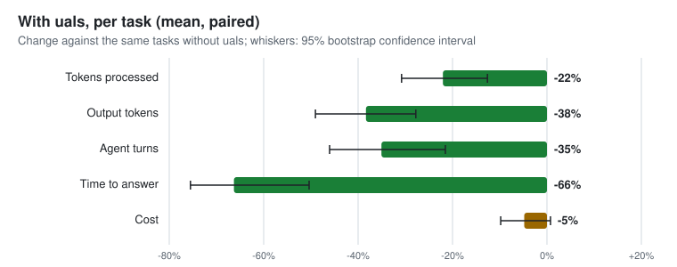
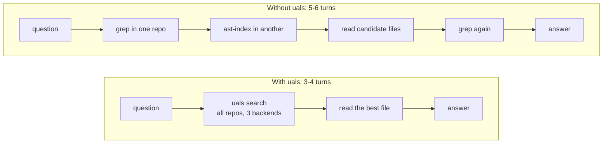
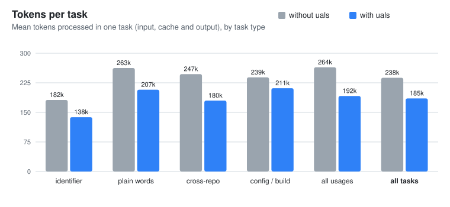
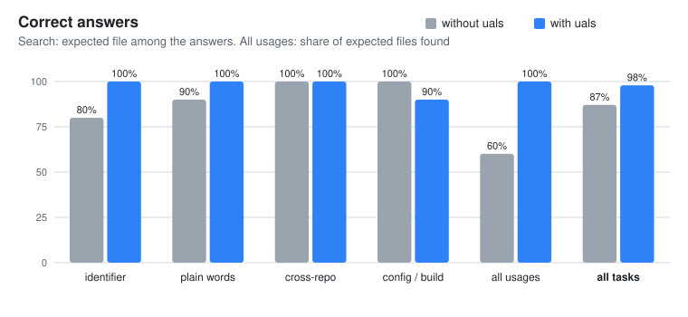
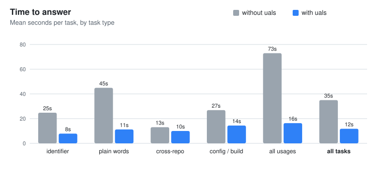
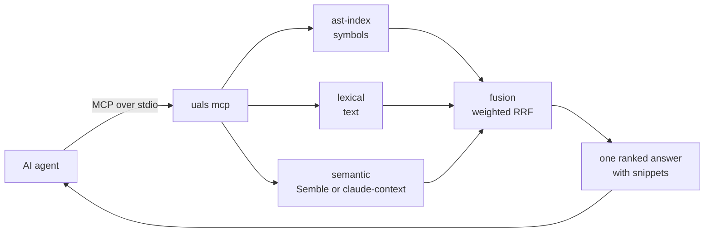
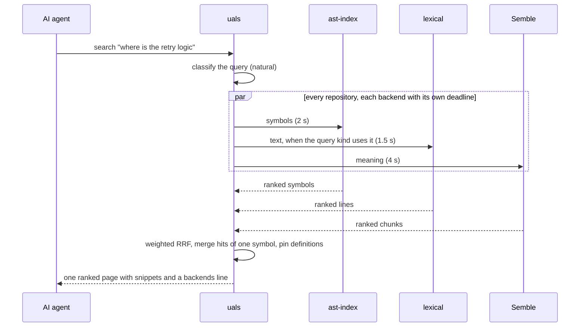

# uals: local code search MCP server for AI coding agents

**One fast code search for Claude Code and other MCP clients: symbol search, text and regex search, semantic search and IDE-precise find-usages over every repository in a folder. Everything runs on your machine.**

uals (ultimate-ai-local-search) is a Rust MCP (Model Context Protocol) server and a command line tool.

It searches every repository in a folder at once, with three backends: symbols (ast-index), text (an in-process search built on the ripgrep crates) and meaning (Semble by default: a local model on the CPU, no API key and no network; claude-context with Milvus as an option). It fuses the answers into one ranked list with code snippets. For find-usages it asks the language servers you have installed (kotlin-lsp, jdtls, gopls, rust-analyzer, typescript-language-server, pyright, clangd, sourcekit-lsp), so it tells apart two functions with the same name, the way an IDE does. See [Precise usages](#precise-usages).

Languages: Kotlin, Java, Go, Rust, TypeScript, JavaScript, Python, C, C++, Swift and every other language ast-index and text search cover. Works for a monorepo and for a folder of several repositories.

uals is not a hosted service. It has no account, no server of its own and no telemetry. It opens no network ports.

On 24 real code-search tasks, Claude Code with uals needed a third fewer turns, a fifth fewer tokens and two thirds less time, and found the right code more often. See [What it saves](#what-it-saves).

## What it saves

Claude Code (Sonnet) solved the same 24 code-search tasks with uals and without it, twice each. The code base: 4 private Android and Kotlin repositories in one folder, about 4 300 indexed source files. Without uals, the agent had the built-in Read, Grep and Glob tools and the ast-index command line. Everything else was the same in both runs: the model, the instructions, the hooks and the permissions.



| Per task, mean | Without uals | With uals | Change |
|---|---:|---:|---:|
| Tokens processed (input, cache, output) | 238k | 185k | −22% |
| Output tokens | 1 096 | 676 | −38% |
| Agent turns | 5.6 | 3.7 | −35% |
| Time to answer | 35 s | 12 s | −66% |
| Cost | $0.139 | $0.132 | −5% (in the noise) |
| Correct answers | 87% | 98% | +11 points |

**Why the cost hardly changes.** Most of the cost of a short task is the first write of the system prompt and the tool list into the prompt cache, and that is the same with and without uals. uals cuts what grows while the agent works: turns, tool output that the model reads back, and the model's own text. In a long session the saving adds up, because the context of every later turn carries it.

**Where the turns go.** Without uals, the agent searches one repository at a time and checks each hit by reading files. With uals, one call covers every repository and returns ranked hits with code, so the agent reads only the best file.



<p>
  
  
</p>
<p>
  
</p>

The largest gain is on "list every usage of a symbol": 100% of the expected files found instead of 60%, in 16 s instead of 73 s. For config and build questions uals was not better: 90% against 100%, one miss in 10 runs.

**Method.** 20 search tasks, 5 of each kind (identifier, plain words, cross-repository, config and build), come from half B of the gold set used in the [benchmark below](#search-quality-benchmark). 4 more tasks ask for every usage of a symbol. A search answer is correct when it names the expected file. For a usage task the score is the share of expected files the answer names. Each task ran twice in each arm, 96 runs in all, with `claude -p` and JSON output. The token counts come from that output. The changes in the chart are paired by task, and the whiskers show a 95% bootstrap confidence interval. The tasks and answers are private; only these aggregates are published. Measured on 13 November 2026 with Claude Code 2.1.304 and Claude Sonnet 5.5.

## How it works



One search, step by step:



**Query kinds.** uals decides the kind of a query from its text. The `kind` parameter overrides this.

| Query | Kind | Backends asked (fusion weight) |
|---|---|---|
| `/retry.*/` | regex | lexical (1.0) |
| `"exact text"` | literal | lexical (1.0) |
| `HostSelector`, `mark_failed`, `sample.core.Analytics`, `retry()` | identifier | ast-index (1.0), lexical (0.7), semantic (0.3) |
| `retry`, `where is the retry logic` | natural | ast-index (0.7), semantic (1.0) |

A single token is an identifier when it has an uppercase letter, `_`, `$`, a separator (`.`, `::`, `#`) or `()`. One plain lowercase word is a natural query. A weight of 0 means the backend is not asked. The weights are in the config (`fusion.weights`).

**Exact text.** The text search is not asked for a natural query, even for one lowercase word: `retry` finds symbol names and meaning, not every line with that word. To search text, quote the string (`"connection refused"`), write a `/regex/`, or set `kind` to `literal` or `regex`. Those queries use the text search only. An identifier query also uses it, with weight 0.7.

**Fusion.** Every backend gives one list over all repositories. A hit adds `weight / (k + rank + 1)` to its score, with `k = 60`. Raw backend scores do not count. Ranks that come from one repository at a time are interleaved: the first hits of all repositories, then the second hits.

**Merge by symbol.** Hits that point into the same enclosing symbol (class, function) become one result, whichever backend found them. Hits outside any known symbol join when their line ranges are at most 3 lines apart. A result lists its sources, for example `ast-index#1 lexical#1 semble#2`.

**Pinning.** For identifier queries, up to 3 results that define the exact name come first.

**Output limit and paging.** A page has 12 results by default and at most 30. The answer ends with `next: offset=N` when more results remain. One answer is cut to 24 000 characters: snippets go first, from the last result upwards, then whole results. The first result always stays.

**Backend status.** Every answer has a `backends:` line. It lists each repository and each backend with its state (`ok`, `stale`, `partial`, `timeout`, `unavailable`, `failed`), the reason and the time.

**Partial answers.** Each backend has a deadline per call: ast-index 2 s, lexical 1.5 s, semantic 4 s (5 s for the first call). A backend that misses its deadline or fails loses only its own results. The answer goes out without them, and the `backends:` line says why.

## Install

```bash
git clone https://github.com/zhimbura/ultimate-ai-local-search.git
cd ultimate-ai-local-search
./install.sh
```

Then restart your agent. `install.sh` runs on macOS and Linux from a checkout.

**What it installs and where:**

- The `uals` binary in `~/.local/bin`: a release archive checked by SHA-256, or built from this checkout with `--from-source`.
- ast-index 3.56.0 in the same folder, unless ast-index 3.56.0 or newer is already on `PATH`.
- The semantic backend. For `semble` (default): Semble 0.7.3 in its own folder, `~/.local/share/uals/semble`, with its own Python when the system has no Python 3.10 or newer. The installer takes uv from `PATH`; when there is none, it downloads uv into that folder. Only `uals` and `ast-index` go into `~/.local/bin`. A Semble 0.7.3 that is already on `PATH` is used as it is. For `claude-context`: see below.
- A file in `~/.local/bin` that the installer did not put there is moved aside to `<name>.bak.<time>` first. `uninstall.sh` puts it back.
- `${XDG_CONFIG_HOME:-~/.config}/uals/config.toml` with absolute tool paths, only when no config exists. An existing config is never changed, even when `--semantic` names another backend: to switch, edit `semantic.default`. API keys stay out of it.
- The `uals` entry in the Claude Code config (`~/.claude.json`). `scripts/configure-mcp.sh` writes the file atomically and tries again when the file changed during the edit. Before a rewrite it saves a backup, `<config>.bak.YYYYmmdd-HHMMSS`. The 3 newest backups of that form stay and older ones are deleted.
- `~/.local/share/uals/install-manifest`: a record of what the installer created, used by `uninstall.sh`.

At the end it runs `uals doctor` and exits with its code. It never edits shell rc files: if `~/.local/bin` is not on your `PATH`, add it yourself.

**Flags:**

| Flag | Meaning |
|---|---|
| `--semantic semble\|claude-context\|none` | Semantic backend. Default: `semble`. |
| `-y`, `--yes` | Never prompt. |
| `--from-source` | Build uals from this checkout with cargo (`--locked`). |
| `--version <tag>` | Release to install. Default: the latest GitHub release. Before the first release, use `--from-source`. |
| `--bin-dir <dir>` | Where binaries go. Default: `~/.local/bin`. |
| `--skip-ast-index` | Do not install ast-index. |
| `--no-mcp` | Do not register uals in the Claude Code config. |
| `--remove-claude-context` | Remove direct claude-context MCP entries from that config. |
| `--no-doctor` | Do not run `uals doctor` at the end. |
| `--provider`, `--model`, `--dimension` | claude-context only: the embedder (`ollama`, `lmstudio`, `openai`, `voyageai`, `gemini`, `openrouter`). |
| `-h`, `--help` | Show the help. |

Environment: `UALS_DOWNLOAD_BASE` (release download base URL, for tests), `CLAUDE_CONFIG` (the Claude Code config; default `~/.claude.json`), `UALS_CONFIG` (the uals config to write). For the claude-context option also: the API keys of the embedder providers, `OLLAMA_HOST`, `MILVUS_PORT`, `MILVUS_HEALTH_PORT` and `MILVUS_VERSION` (see `.env.example`).

**Re-run safety.** You can run `install.sh` again. It skips what is installed, keeps your config and records only what it created.

**The claude-context option.** `./install.sh --semantic claude-context` also sets up:

- Docker with one Milvus container (`docker-compose.yml`), bound to `127.0.0.1` only.
- An embedder: Ollama or LM Studio on your machine, or a cloud provider with your key.
- Node 22.12.0 or newer, and `@zilliz/claude-context-mcp` 0.1.16 installed with npm into `~/.local/share/uals/claude-context`. uals never runs `npx` at run time.
- `.env` in the checkout (mode 600, gitignored): the Milvus and embedder settings and the API key. A cloud API key goes into the `env` of the uals entry in the Claude Code config, never into `config.toml`.

Only one uals process at a time may run claude-context. Milvus is slower to set up than Semble, and on the benchmark below it was not better. Pick it only if you have a reason.

## Use

### MCP tools

The server name is `uals`. Claude Code shows the tools as `mcp__uals__search`, `mcp__uals__usages` and `mcp__uals__status`.

**`search`**

| Parameter | Default | Meaning |
|---|---|---|
| `query` | required | What to look for. See the query kinds above. |
| `workspace` | see below | The folder whose repositories are searched. |
| `repos` | all | Names of the repositories to search, as `status` lists them. |
| `kind` | `auto` | `auto`, `identifier`, `natural`, `regex` or `literal`. |
| `paths` | every file | Globs relative to each repository root, gitignore style: `src/**/*.kt` selects, `!**/test/**` excludes. |
| `limit` | 12 | Results per page. At most 30. |
| `offset` | 0 | Results to skip: the `next: offset=N` of the previous page. |
| `format` | `concise` | `concise`, `detailed` (adds scores, raw source ranks and longer snippets) or `json`. |

**`usages`** lists every usage of a symbol, grouped by repository and file. It uses the ast-index index of a repository when there is one, and a whole-word text search otherwise. Each repository names the source that answered. When a language server is installed, the answer also says which declaration each usage refers to; see [Precise usages](#precise-usages).

| Parameter | Default | Meaning |
|---|---|---|
| `symbol` | required | The symbol, for example `HostSelector` or `markFailed`. `Store.load` asks for the `load` declared in `Store` only. |
| `workspace`, `repos` | as in `search` | |
| `limit` | 100 | Usages per page. At most 1000. |
| `offset` | 0 | Usages to skip. |
| `format` | `concise` | As in `search`. |

**`status`** shows, for every repository, whether each backend has an index, when it was updated, and why a backend is not available. Parameters: `workspace`, `repos`, `format`.

### Precise usages

A name search cannot tell two functions called `load` apart. A language server can, the way an IDE does. When the server of a file's language is installed, `usages` asks it which usages refer to which declaration:

```text
usages of "Cache.stop" · 3 in 3 files · complete
definitions:
  [1] function Cache.stop · /work/app/src/main/kotlin/demo/Cache.kt:4 · kotlin-lsp: 2 usages
  [2] function Cache.stop · /work/web/src/store.ts:6 · typescript-language-server: 1 usage
app (ast-index)
  /work/app/src/main/java/demo/Other.java: 5[1]
  /work/app/src/main/kotlin/demo/Use.kt: 6[1]
web (ast-index)
  /work/web/src/use.ts: 5[2]
```

- `[n]` after a line number is the declaration the usage refers to. A line without `[n]` was found by name only.
- `Container.name` keeps the usages of that declaration. A usage by name that the server did not return, in a file the server loaded, refers to another declaration and is left out. Without a container, every usage stays.
- The declarations come from the ast-index index, so precise usages need one (`uals refresh`).
- A server that is missing, still loading, or cannot load the project does not break the answer: its declaration says `by name:` and why, and its usages are found by name.

| Language | Server | Project root (nearest folder with) |
|---|---|---|
| Kotlin | `kotlin-lsp` | `settings.gradle(.kts)`, else `build.gradle(.kts)` or `pom.xml` |
| Java | `jdtls` | the same as Kotlin |
| Go | `gopls` | `go.work`, else `go.mod` |
| Rust | `rust-analyzer` | `Cargo.toml` |
| TypeScript, JavaScript | `typescript-language-server` | `tsconfig.json` or `jsconfig.json`, else `package.json` |
| Python | `basedpyright-langserver` or `pyright-langserver` | `pyrightconfig.json`, `pyproject.toml`, `setup.py` or `setup.cfg` |
| C, C++, Objective-C | `clangd` | `compile_commands.json`, `compile_flags.txt` or `.clangd`, else `CMakeLists.txt` |
| Swift | `sourcekit-lsp` | `Package.swift` |

**kotlin-lsp and jdtls are off by default.** To load a Gradle project they run a Gradle sync: it takes minutes, starts Gradle and Kotlin daemons and can take several gigabytes. Turn each one on in the config:

```toml
[lsp.servers.kotlin-lsp]
enabled = true
```

uals starts jdtls with `--jvm-arg=-Djava.import.generatesMetadataFilesAtProjectRoot=false` and its build off, so jdtls keeps its Eclipse files (`.project`, `.classpath`, `.settings/`) in its state folder and writes no `bin/` folders. A `command` of your own for jdtls must keep that argument. Files an older jdtls left in a project stay there until you delete them. The Gradle sync itself still writes `.gradle/` and `build/` in the project, as any Gradle build does.

**Several languages in one folder.** uals runs one server per language and project. A folder with a Go module and a Gradle project runs gopls, kotlin-lsp and jdtls side by side (with the last two turned on), each on its own project. kotlin-lsp also returns the Java callers of a Kotlin declaration.

**Start and memory.** A server starts on the first `usages` call that needs it. That call waits at most `lsp.ready_wait_ms` (10 s) for the project to load. A large Gradle project takes longer, so the first answers are by name until kotlin-lsp is ready. A server stops after `lsp.idle_minutes` (30) without calls. kotlin-lsp takes about 1.6 GB per project. `status` lists the running servers; `doctor` lists the installed ones.

**Limits.** clangd needs a `compile_commands.json` and sourcekit-lsp a built index; when they return nothing, uals does not trust the empty answer and keeps the usages by name. Name search finds one usage per line, so a line with two calls gets the mark of one of them. kotlin-lsp 271 fails the import of many Android projects ([Kotlin/kotlin-lsp#253](https://github.com/Kotlin/kotlin-lsp/issues/253)). uals passes it a Gradle init script that turns off the androidTest and unit-test components of Android variants for the import only; the import then passes, but usages from test sources are found by name only. The first import of a large Android project takes about 5 minutes and up to 5 GB, a later one about 2 minutes. jdtls does not load Android modules. A server that reports that it could not load the project gets no trust for an empty answer: its usages are found by name.

### Command line

The commands take the same parameters as the tools and print the same text. List-valued parameters are repeated flags (`--repo`, `--path`).

```bash
uals search HostSelector                          # an identifier
uals search "where is the retry logic"            # by meaning
uals search '/retry\(.*\)/' --path 'src/**/*.kt'  # a regex in some files
uals search '"connection refused"' --limit 5      # an exact string
uals search HostSelector --repo android --format json
uals usages markFailed --workspace ~/code
uals usages Store.load                            # only the load declared in Store
uals status
uals refresh                  # update the indexes
uals refresh --full           # rebuild them
uals workspace                # print the repositories uals found, as JSON
uals doctor                   # check the installation
uals mcp                      # run the MCP server on stdin and stdout
uals hook post-edit           # Claude Code hook, reads JSON on stdin
```

`uals refresh` exits with 1 when a backend failed. A backend that is unavailable is reported but is not a failure. `uals refresh` and `uals doctor` take `--format concise|detailed|json`; for both, `detailed` prints the same as `concise`. The global option `--config <file>` works with every command.

### Which folder is searched

1. The `workspace` parameter or the `--workspace` flag.
2. In the MCP server: the first local root folder of the client, when the client lists its roots within 2 seconds.
3. `$UALS_WORKSPACE`.
4. The folder the process runs in.

uals finds the repositories of that folder like this. The first rule that applies wins:

1. A configured workspace (`[workspaces.<name>]`) whose root is the folder or one of its parents.
2. The nearest folder at or above it with `.git` (never the home folder or `/`): that one repository.
3. Repositories below the folder, up to 2 levels down: folders with `.git`, `settings.gradle(.kts)`, `build.gradle(.kts)`, `pom.xml`, `package.json`, `Cargo.toml`, `go.mod`, `pyproject.toml`, `setup.py`, `Package.swift` or `pubspec.yaml`. Hidden folders and `build`, `node_modules`, `target`, `dist`, `out`, `vendor`, `Pods`, `DerivedData` are skipped.
4. The folder itself, when it has one of these markers.

`uals workspace` shows the result.

### Register the MCP server by hand

`install.sh` does this for you. For Claude Code:

```bash
claude mcp add --scope user uals -- ~/.local/bin/uals mcp
```

Or add this to the `mcpServers` object in `~/.claude.json`, with the absolute path of the binary (the same entry is in [mcp/uals.template.json](mcp/uals.template.json)):

```json
{
  "mcpServers": {
    "uals": {
      "type": "stdio",
      "command": "/absolute/path/to/uals",
      "args": ["mcp"],
      "env": {}
    }
  }
}
```

For any other MCP client, start `uals mcp` as a stdio server with the same command and arguments. Put variables such as `UALS_WORKSPACE`, `UALS_CONFIG` or `UALS_LOG` in the `env` object.

Only if you pick claude-context with a cloud embedder (OpenAI, VoyageAI, Gemini, OpenRouter), its API key goes into `env`. Semble, Ollama and LM Studio need no key.

```json
"env": { "OPENAI_API_KEY": "sk-REPLACE_ME" }
```

## Configuration

uals reads one TOML file. It looks for it in this order:

1. `--config <file>`
2. `$UALS_CONFIG`
3. `$XDG_CONFIG_HOME/uals/config.toml`
4. `~/.config/uals/config.toml`

A missing default file means all defaults. A missing file named with `--config` is an error. Every key has a default, so the file lists only what you change. An unknown key is an error.

**Secrets never go into the file.** List the names of environment variables in `pass_env`: uals copies them from its own environment to the backend process.

The values below are the defaults, except where a comment says otherwise.

```toml
[semantic]
default = "semble"              # "semble", "claude-context" or "none"

[semantic.semble]
command = ["semble"]            # the Semble MCP server (stdio)
env = {}                        # literal values only, no secrets
pass_env = []
# content = "code"              # "code", "docs", "config" or "all"; unset: Semble's own default

[semantic.claude_context]       # used only when default = "claude-context"
node = "node"
# entry = "/absolute/path/to/claude-context-mcp/dist/index.js"   # default: the npm install under ~/.local/share/uals/claude-context
env = { MILVUS_ADDRESS = "127.0.0.1:19530" }   # example; the default is an empty table
pass_env = ["OPENAI_API_KEY"]                  # example; the default is an empty list
ignore_patterns = ["**/build/**", "**/node_modules/**", "**/.gradle/**"]
custom_extensions = [".kts"]

[ast_index]
binary = "ast-index"
update_on_start = true          # update existing ast-index indexes when `uals mcp` starts

[lsp]                           # precise usages; see "Precise usages"
enabled = true
ready_wait_ms = 10000           # how long a call waits for a server that is loading its project
request_ms = 20000              # deadline of one request to a loaded server
idle_minutes = 30               # a server unused this long is stopped

# [lsp.servers.kotlin-lsp]      # one table per server, by its name; every key is optional
# enabled = true                # default: off for kotlin-lsp and jdtls, on for the others
# command = ["kotlin-lsp", "--stdio", "--data-sharing=none", "--system-path={state}"]   # {state}: a per-project folder under the user cache
# env = {}
# pass_env = []
# java_home = "/path/to/jdk-17" # JVM servers (kotlin-lsp, jdtls); default: JAVA_HOME of uals

[lexical]
max_matches_per_file = 10
max_hits_per_file = 3
max_candidates = 500
max_line_chars = 300
max_file_size_bytes = 2097152   # larger files are skipped
# [[lexical.downrank]]          # paths whose hits rank lower; setting this replaces the built-in rules
# pattern = '(^|/)generated/'
# factor = 0.3                  # in (0, 1]

[deadlines]
ast_index_ms = 2000
lexical_ms = 1500
semantic_ms = 4000
semantic_cold_ms = 5000         # the first semantic call

[fusion]
rrf_k = 60.0
fetch_factor = 5                # each backend is asked for output.max_limit * fetch_factor hits per repository
max_pinned = 3
merge_gap_lines = 3

[fusion.weights.identifier]     # a tier you write lists all three weights: omitted ones become 0
ast_index = 1.0
lexical = 0.7
semantic = 0.3

[fusion.weights.natural]
ast_index = 0.7
lexical = 0.0
semantic = 1.0

[fusion.weights.regex]
ast_index = 0.0
lexical = 1.0
semantic = 0.0

[fusion.weights.literal]
ast_index = 0.0
lexical = 1.0
semantic = 0.0

[output]
default_limit = 12
max_limit = 30
max_snippet_lines = 20
max_output_chars = 24000

# Optional: name a workspace, or list its repositories yourself.
# [workspaces.work]
# root = "/absolute/path/to/work"
# exclude = ["docs"]            # folders discovery skips
# [[workspaces.work.repos]]     # when set, discovery is skipped
# name = "android"
# path = "android"              # absolute, or relative to root
```

The lexical `downrank` list has built-in rules for build output, generated code, tests, translations and tool folders. See `crates/uals-core/src/config.rs` for the list.

## Keeping indexes fresh

- **On start.** When `uals mcp` starts, and `ast_index.update_on_start` is true, it updates the ast-index index of every repository that already has one. It does not create indexes. It does not prepare the home folder, `/` or a folder above the home folder, and it does not prepare a workspace with more than 16 repositories (its backends start on first use).
- **By hand.** `uals refresh` updates the indexes of all backends. `uals refresh --full` rebuilds them. Use `--workspace` and `--repo <name>` to narrow it. ast-index needs this once per repository: it never creates an index by itself. Semble builds its index on the first search.
- **After each edit (optional).** `uals hook post-edit` is a Claude Code `PostToolUse` hook. It reads the hook input on stdin, finds the repository of the edited file and runs an incremental `ast-index update` there. It does nothing when the repository has no index or the file is in no repository. Add it to `~/.claude/settings.json`:

```json
{
  "hooks": {
    "PostToolUse": [
      {
        "matcher": "Edit|MultiEdit|Write|NotebookEdit",
        "hooks": [
          { "type": "command", "command": "uals hook post-edit" }
        ]
      }
    ]
  }
}
```

If `uals` is not on the `PATH` of Claude Code, write the full path in `command`. The hook stops its update after 50 seconds, before the default hook timeout of Claude Code (60 seconds).

## Troubleshooting

- `uals doctor` checks the config, ast-index, the semantic backend and the MCP registration. One line per check: `✓` ok, `!` warning, `✗` failure, `-` skipped. It exits with 1 when a check failed.
- `uals doctor` does more than read. For Semble it runs a search in a temporary folder under the system temp folder; the first run may download the model and may take up to 120 s. For claude-context it calls the local embedder and creates and then deletes a test collection `uals_doctor_<pid>` in Milvus.
- `uals status` shows what each backend knows about each repository. `not indexed (no index; run ...)` means run `uals refresh`.
- `uals workspace` shows which repositories uals found. If the list is wrong, pass `--workspace` or add a `[workspaces.<name>]` entry.
- Logs go to stderr, never to stdout (stdout carries the MCP protocol). The default level is `warn`. For more: `UALS_LOG=debug uals search HostSelector`. In an MCP client, set `UALS_LOG` in the `env` of the server entry and read the client's MCP log.
- A `backends:` line with `timeout` means that backend missed its deadline. The first Semble search of a repository builds its index and can be slow; raise `deadlines.semantic_cold_ms` or run `uals refresh` first.

## Privacy

- Everything runs on your machine. The MCP transport is stdio. uals opens no ports.
- Milvus (claude-context option only) listens on `127.0.0.1` only. `uals doctor` probes Milvus and a local embedder over plain HTTP on `127.0.0.1`.
- `install.sh` downloads from: GitHub releases (the uals archive, ast-index, and uv when it is missing), PyPI through uv (Semble), uv's Python builds on GitHub (only when no Python 3.10 or newer is found), npm (`@zilliz/claude-context-mcp`) and Docker Hub (the Milvus image). The uals archive and uv are checked against their published SHA-256 files. ast-index has no checksum files, so `install.sh` holds the SHA-256 of each ast-index archive.
- For the claude-context option only, `install.sh` can also install an embedder: Ollama (Homebrew on macOS, the ollama.com install script on Linux) or LM Studio (Homebrew on macOS).
- Semble downloads its embedding model on first use.
- With claude-context and a cloud embedder (OpenAI, VoyageAI, Gemini, OpenRouter), code chunks are sent to that provider. With Ollama or LM Studio they stay on your machine.
- uals sends no telemetry.
- The benchmark queries are private. Only aggregate numbers are published.
- CI checks tracked files only for absolute home paths (`/Users/…`, `/home/…`). Private names are caught only by the local pre-commit hook, which reads a deny-list on the developer's machine (`scripts/check-private.sh`). CI does not have that list.

## Search quality benchmark

This benchmark measures uals itself, without an agent. The semantic backend was chosen with a rule written before the measurement: claude-context becomes the default only if it beats Semble on natural-language queries, with the lower bound of the 95% confidence interval above 0. It did not. Semble stays the default.

MRR of the first expected file, 40 queries of half B of a private gold set over 4 repositories:

| type | n | no semantics | Semble | claude-context |
|---|---:|---:|---:|---:|
| identifier | 10 | 1.000 | 0.950 | 0.950 |
| natural | 10 | 0.053 | 0.008 | 0.021 |
| cross_repo | 10 | 0.361 | 0.392 | 0.317 |
| config | 10 | 0.000 | 0.013 | 0.000 |
| all | 40 | 0.354 | 0.341 | 0.322 |

On this set no semantic backend beats fused search without semantics, and every configuration misses most natural queries. Setup, weights and notes: [docs/semantic-gate.md](docs/semantic-gate.md).

## Uninstall

```bash
./uninstall.sh              # undo what the install manifest records
./uninstall.sh --yes        # without prompts
./uninstall.sh --purge      # also delete the Milvus volume (your claude-context index)
```

What it does:

- Removes only the top-level `uals` entry in `~/.claude.json` and puts back the `uals` entry that was there before the install. `uals` entries inside projects are not touched.
- Deletes `~/.claude.json` when nothing is left in it except an empty `mcpServers`.
- Restores claude-context entries that the installer removed. Entries of projects that no longer exist stay in the saved file.
- Deletes the files the installer created, puts back files it moved aside, and puts back the earlier `.env`.
- Removes Semble and the uv the installer installed, and stops the Docker stack when the installer started it.
- A failed step does not stop it. Failed steps stay in the manifest and the exit code is 1.

`--purge` is irreversible.

## Development

```bash
cargo build --locked
cargo test --workspace --locked
cargo clippy --workspace --all-targets --locked -- -D warnings
cargo fmt --all --check
cargo deny check                 # licenses, advisories, sources (deny.toml)
scripts/check-private.sh         # no absolute home paths or private names in tracked files
git config core.hooksPath .githooks   # run check-private.sh before every commit
```

`rust-toolchain.toml` pins the Rust toolchain. CI runs fmt, clippy and tests on Linux and macOS, plus cargo-deny, `check-private.sh` and shellcheck. The `install` job builds a release binary, packs it with `scripts/package-release.sh` (the script the release workflow uses), then runs `scripts/ci-install-check.sh` on Linux (x86_64, musl) and macOS (arm64): install, install again (the manifest and the `~/.claude.json` backups do not change), `uals doctor`, uninstall (files return to the state before the install). `scripts/check-pins.sh` checks that the tool versions in `install.sh` match the ones `uals doctor` was tested with.

**Crates:**

| Crate | Role |
|---|---|
| `crates/uals-core` | Types, config, query classification, workspace discovery, fusion, merge and output. No I/O to backends. |
| `crates/uals-adapters` | The backends: ast-index, lexical search, Semble, claude-context, and the MCP child process they use. |
| `crates/uals` | The binary: the CLI, the MCP server, the orchestrator and the hook. |
| `crates/uals-bench` | `uals-bench`: runs a gold query set, compares runs and writes reports. |

**Test fixtures:** a sample workspace of three small repositories is in `tests/fixtures/workspace/`. Recorded outputs of ast-index, Semble and claude-context are in `crates/uals-adapters/tests/fixtures/`. Golden cases for classification and fusion are in `crates/uals-core/tests/golden/`. Test files with `live` in the name need the real tools.

## Platforms and license

macOS and Linux. Windows is not supported yet. Release binaries: macOS (arm64, x86_64) and Linux with musl (x86_64, arm64).

MIT. See [LICENSE](LICENSE). uals configures third-party tools (ast-index, Semble, claude-context, Milvus, Ollama, LM Studio) that have their own licenses.
