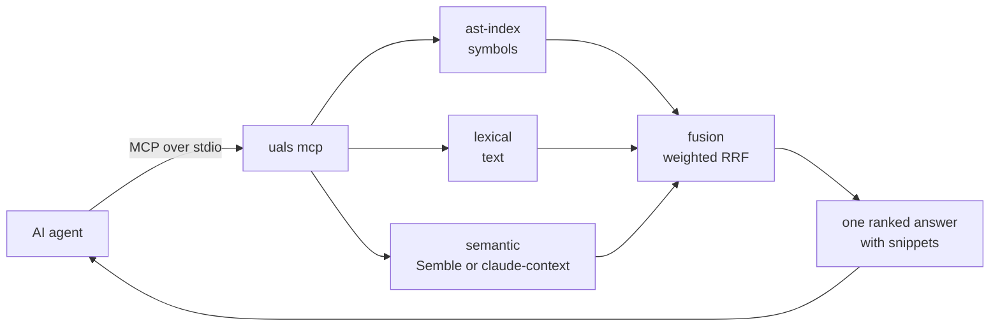

# uals

uals (ultimate-ai-local-search) is one code search for AI coding agents. It is a Rust MCP server and a command line tool.

It searches every repository in a folder at once, with three backends: symbols (ast-index), text (an in-process search built on the ripgrep crates) and meaning (Semble by default, claude-context with Milvus as an option). It fuses the answers into one ranked list with code snippets.

uals is not a hosted service. It has no account, no server of its own and no telemetry. It opens no network ports.

## How it works



**Query kinds.** uals decides the kind of a query from its text. The `kind` parameter overrides this.

| Query | Kind | Backends asked (fusion weight) |
|---|---|---|
| `/retry.*/` | regex | lexical (1.0) |
| `"exact text"` | literal | lexical (1.0) |
| `HostSelector`, `mark_failed`, `sample.core.Analytics`, `retry()` | identifier | ast-index (1.0), lexical (0.7), semantic (0.3) |
| `retry`, `where is the retry logic` | natural | ast-index (0.7), semantic (1.0) |

A single token is an identifier when it has an uppercase letter, `_`, `$`, a separator (`.`, `::`, `#`) or `()`. One plain lowercase word is a natural query. A weight of 0 means the backend is not asked. The weights are in the config (`fusion.weights`).

**Fusion.** Every backend gives one list over all repositories. A hit adds `weight / (k + rank + 1)` to its score, with `k = 60`. Raw backend scores do not count. Ranks that come from one repository at a time are interleaved: the first hits of all repositories, then the second hits.

**Merge by symbol.** Hits that point into the same enclosing symbol (class, function) become one result, whichever backend found them. Hits outside any known symbol join when their line ranges are at most 3 lines apart. A result lists its sources, for example `ast-index#1 lexical#1 semble#2`.

**Pinning.** For identifier queries, up to 3 results that define the exact name come first.

**Output limit and paging.** A page has 12 results by default and at most 30. The answer ends with `next: offset=N` when more results remain. One answer is cut to 24 000 characters: snippets go first, from the last result upwards, then whole results. The first result always stays.

**Backend status.** Every answer has a `backends:` line. It lists each repository and each backend with its state (`ok`, `stale`, `partial`, `timeout`, `unavailable`, `failed`), the reason and the time.

**Partial answers.** Each backend has a deadline per call: ast-index 2 s, lexical 1.5 s, semantic 4 s (5 s for the first call). A backend that misses its deadline or fails loses only its own results. The answer goes out without them, and the `backends:` line says why.

## Install

```bash
git clone https://github.com/zhimbura/ultimate-ai-local-search.git
cd ultimate-ai-local-search
./install.sh
```

Then restart your agent. `install.sh` runs on macOS and Linux from a checkout.

**What it installs and where:**

- The `uals` binary in `~/.local/bin`: a release archive checked by SHA-256, or built from this checkout with `--from-source`.
- ast-index 3.56.0 in the same folder, unless ast-index 3.56.0 or newer is already on `PATH`.
- The semantic backend. For `semble` (default): uv 0.10.5 in the same folder when uv is missing, then `uv tool install 'semble[mcp]==0.7.3'`, with the `semble` command in the same folder. For `claude-context`: see below.
- A file in that folder that the installer did not put there is moved aside to `<name>.bak.<time>` first. `uninstall.sh` puts it back.
- `~/.config/uals/config.toml` with absolute tool paths, only when no config exists. An existing config is never changed. API keys stay out of it.
- The `uals` entry in the Claude Code config (`~/.claude.json`), with a timestamped backup.
- `~/.local/share/uals/install-manifest`: a record of what the installer created, used by `uninstall.sh`.

At the end it runs `uals doctor` and exits with its code. It never edits shell rc files: if `~/.local/bin` is not on your `PATH`, add it yourself.

**Flags:**

| Flag | Meaning |
|---|---|
| `--semantic semble\|claude-context\|none` | Semantic backend. Default: `semble`. |
| `-y`, `--yes` | Never prompt. |
| `--from-source` | Build uals from this checkout with cargo (`--locked`). |
| `--version <tag>` | Release to install. Default: the latest GitHub release. Before the first release, use `--from-source`. |
| `--bin-dir <dir>` | Where binaries go. Default: `~/.local/bin`. |
| `--skip-ast-index` | Do not install ast-index. |
| `--no-mcp` | Do not register uals in the Claude Code config. |
| `--remove-claude-context` | Remove direct claude-context MCP entries from that config. |
| `--no-doctor` | Do not run `uals doctor` at the end. |
| `--provider`, `--model`, `--dimension` | claude-context only: the embedder (`ollama`, `lmstudio`, `openai`, `voyageai`, `gemini`, `openrouter`). |
| `-h`, `--help` | Show the help. |

Environment: `UALS_DOWNLOAD_BASE` (release download base URL, for tests), `CLAUDE_CONFIG` (the Claude Code config; default `~/.claude.json`), `UALS_CONFIG` (the uals config to write). For the claude-context option also: the API keys of the embedder providers, `OLLAMA_HOST`, `MILVUS_PORT`, `MILVUS_HEALTH_PORT` and `MILVUS_VERSION` (see `.env.example`).

**Re-run safety.** You can run `install.sh` again. It skips what is installed, keeps your config and records only what it created.

**The claude-context option.** `./install.sh --semantic claude-context` also sets up:

- Docker with one Milvus container (`docker-compose.yml`), bound to `127.0.0.1` only.
- An embedder: Ollama or LM Studio on your machine, or a cloud provider with your key.
- Node 22.12.0 or newer, and `@zilliz/claude-context-mcp` 0.1.15 installed with npm into `~/.local/share/uals/claude-context`. uals never runs `npx` at run time.
- `.env` in the checkout (mode 600, gitignored): the Milvus and embedder settings and the API key. A cloud API key goes into the `env` of the uals entry in the Claude Code config, never into `config.toml`.

Only one uals process at a time may run claude-context. Milvus is slower to set up than Semble, and on the benchmark below it was not better. Pick it only if you have a reason.

## Use

### MCP tools

The server name is `uals`. Claude Code shows the tools as `mcp__uals__search`, `mcp__uals__usages` and `mcp__uals__status`.

**`search`**

| Parameter | Default | Meaning |
|---|---|---|
| `query` | required | What to look for. See the query kinds above. |
| `workspace` | see below | The folder whose repositories are searched. |
| `repos` | all | Names of the repositories to search, as `status` lists them. |
| `kind` | `auto` | `auto`, `identifier`, `natural`, `regex` or `literal`. |
| `paths` | every file | Globs relative to each repository root, gitignore style: `src/**/*.kt` selects, `!**/test/**` excludes. |
| `limit` | 12 | Results per page. At most 30. |
| `offset` | 0 | Results to skip: the `next: offset=N` of the previous page. |
| `format` | `concise` | `concise`, `detailed` (adds scores, raw source ranks and longer snippets) or `json`. |

**`usages`** lists every usage of a symbol, grouped by repository and file. It uses the ast-index index of a repository when there is one, and a whole-word text search otherwise. Each repository names the source that answered.

| Parameter | Default | Meaning |
|---|---|---|
| `symbol` | required | The symbol, for example `HostSelector` or `markFailed`. |
| `workspace`, `repos` | as in `search` | |
| `limit` | 100 | Usages per page. At most 1000. |
| `offset` | 0 | Usages to skip. |
| `format` | `concise` | As in `search`. |

**`status`** shows, for every repository, whether each backend has an index, when it was updated, and why a backend is not available. Parameters: `workspace`, `repos`, `format`.

### Command line

The commands take the same parameters as the tools and print the same text. List-valued parameters are repeated flags (`--repo`, `--path`).

```bash
uals search HostSelector                          # an identifier
uals search "where is the retry logic"            # by meaning
uals search '/retry\(.*\)/' --path 'src/**/*.kt'  # a regex in some files
uals search '"connection refused"' --limit 5      # an exact string
uals search HostSelector --repo android --format json
uals usages markFailed --workspace ~/code
uals status
uals refresh                  # update the indexes
uals refresh --full           # rebuild them
uals workspace                # print the repositories uals found, as JSON
uals doctor                   # check the installation
uals mcp                      # run the MCP server on stdin and stdout
uals hook post-edit           # Claude Code hook, reads JSON on stdin
```

`uals refresh` exits with 1 when a backend failed. A backend that is unavailable is reported but is not a failure. `uals doctor` takes `--format concise|detailed|json`. The global option `--config <file>` works with every command.

### Which folder is searched

1. The `workspace` parameter or the `--workspace` flag.
2. In the MCP server: the first local root folder of the client, when the client lists its roots within 2 seconds.
3. `$UALS_WORKSPACE`.
4. The folder the process runs in.

uals finds the repositories of that folder like this. The first rule that applies wins:

1. A configured workspace (`[workspaces.<name>]`) whose root is the folder or one of its parents.
2. The nearest folder at or above it with `.git` (never the home folder or `/`): that one repository.
3. Repositories below the folder, up to 2 levels down: folders with `.git`, `settings.gradle(.kts)`, `build.gradle(.kts)`, `pom.xml`, `package.json`, `Cargo.toml`, `go.mod`, `pyproject.toml`, `setup.py`, `Package.swift` or `pubspec.yaml`. Hidden folders and `build`, `node_modules`, `target`, `dist`, `out`, `vendor`, `Pods`, `DerivedData` are skipped.
4. The folder itself, when it has one of these markers.

`uals workspace` shows the result.

### Register the MCP server by hand

`install.sh` does this for you. For Claude Code:

```bash
claude mcp add --scope user uals -- ~/.local/bin/uals mcp
```

Or add this to the `mcpServers` object in `~/.claude.json`, with the absolute path of the binary:

```json
{
  "mcpServers": {
    "uals": {
      "type": "stdio",
      "command": "/absolute/path/to/uals",
      "args": ["mcp"],
      "env": {}
    }
  }
}
```

For any other MCP client, start `uals mcp` as a stdio server with the same command and arguments. Put variables such as `UALS_WORKSPACE`, `UALS_CONFIG` or `UALS_LOG` in the `env` object.

## Configuration

uals reads one TOML file. It looks for it in this order:

1. `--config <file>`
2. `$UALS_CONFIG`
3. `$XDG_CONFIG_HOME/uals/config.toml`
4. `~/.config/uals/config.toml`

A missing default file means all defaults. A missing file named with `--config` is an error. Every key has a default, so the file lists only what you change. An unknown key is an error.

**Secrets never go into the file.** List the names of environment variables in `pass_env`: uals copies them from its own environment to the backend process.

The values below are the defaults, except where a comment says otherwise.

```toml
[semantic]
default = "semble"              # "semble", "claude-context" or "none"

[semantic.semble]
command = ["semble"]            # the Semble MCP server (stdio)
env = {}                        # literal values only, no secrets
pass_env = []
# content = "code"              # "code", "docs", "config" or "all"; unset: Semble's own default

[semantic.claude_context]       # used only when default = "claude-context"
node = "node"
# entry = "/absolute/path/to/claude-context-mcp/dist/index.js"   # default: the npm install under ~/.local/share/uals/claude-context
env = { MILVUS_ADDRESS = "127.0.0.1:19530" }   # example; the default is an empty table
pass_env = ["OPENAI_API_KEY"]                  # example; the default is an empty list
ignore_patterns = ["**/build/**", "**/node_modules/**", "**/.gradle/**"]
custom_extensions = [".kts"]

[ast_index]
binary = "ast-index"
update_on_start = true          # update existing ast-index indexes when `uals mcp` starts

[lexical]
max_matches_per_file = 10
max_hits_per_file = 3
max_candidates = 500
max_line_chars = 300
max_file_size_bytes = 2097152   # larger files are skipped
# [[lexical.downrank]]          # paths whose hits rank lower; setting this replaces the built-in rules
# pattern = '(^|/)generated/'
# factor = 0.3                  # in (0, 1]

[deadlines]
ast_index_ms = 2000
lexical_ms = 1500
semantic_ms = 4000
semantic_cold_ms = 5000         # the first semantic call

[fusion]
rrf_k = 60.0
fetch_factor = 5                # each backend is asked for output.max_limit * fetch_factor hits per repository
max_pinned = 3
merge_gap_lines = 3

[fusion.weights.identifier]     # a tier you write lists all three weights: omitted ones become 0
ast_index = 1.0
lexical = 0.7
semantic = 0.3

[fusion.weights.natural]
ast_index = 0.7
lexical = 0.0
semantic = 1.0

[fusion.weights.regex]
ast_index = 0.0
lexical = 1.0
semantic = 0.0

[fusion.weights.literal]
ast_index = 0.0
lexical = 1.0
semantic = 0.0

[output]
default_limit = 12
max_limit = 30
max_snippet_lines = 20
max_output_chars = 24000

# Optional: name a workspace, or list its repositories yourself.
# [workspaces.work]
# root = "/absolute/path/to/work"
# exclude = ["docs"]            # folders discovery skips
# [[workspaces.work.repos]]     # when set, discovery is skipped
# name = "android"
# path = "android"              # absolute, or relative to root
```

The lexical `downrank` list has built-in rules for build output, generated code, tests, translations and tool folders. See `crates/uals-core/src/config.rs` for the list.

## Keeping indexes fresh

- **On start.** When `uals mcp` starts, and `ast_index.update_on_start` is true, it updates the ast-index index of every repository that already has one. It does not create indexes. It does not prepare the home folder, `/` or a folder above the home folder, and it does not prepare a workspace with more than 16 repositories (its backends start on first use).
- **By hand.** `uals refresh` updates the indexes of all backends. `uals refresh --full` rebuilds them. Use `--workspace` and `--repo <name>` to narrow it. ast-index needs this once per repository: it never creates an index by itself. Semble builds its index on the first search.
- **After each edit (optional).** `uals hook post-edit` is a Claude Code `PostToolUse` hook. It reads the hook input on stdin, finds the repository of the edited file and runs an incremental `ast-index update` there. It does nothing when the repository has no index or the file is in no repository. Add it to `~/.claude/settings.json`:

```json
{
  "hooks": {
    "PostToolUse": [
      {
        "matcher": "Edit|MultiEdit|Write|NotebookEdit",
        "hooks": [
          { "type": "command", "command": "uals hook post-edit" }
        ]
      }
    ]
  }
}
```

If `uals` is not on the `PATH` of Claude Code, write the full path in `command`. The hook stops its update after 50 seconds, before the default hook timeout of Claude Code (60 seconds).

## Troubleshooting

- `uals doctor` checks the config, ast-index, the semantic backend and the MCP registration. One line per check: `✓` ok, `!` warning, `✗` failure, `-` skipped. It exits with 1 when a check failed.
- `uals status` shows what each backend knows about each repository. `not indexed (no index; run ...)` means run `uals refresh`.
- `uals workspace` shows which repositories uals found. If the list is wrong, pass `--workspace` or add a `[workspaces.<name>]` entry.
- Logs go to stderr, never to stdout (stdout carries the MCP protocol). The default level is `warn`. For more: `UALS_LOG=debug uals search HostSelector`. In an MCP client, set `UALS_LOG` in the `env` of the server entry and read the client's MCP log.
- A `backends:` line with `timeout` means that backend missed its deadline. The first Semble search of a repository builds its index and can be slow; raise `deadlines.semantic_cold_ms` or run `uals refresh` first.

## Privacy

- Everything runs on your machine. The MCP transport is stdio. uals opens no ports.
- Milvus (claude-context option only) listens on `127.0.0.1` only. `uals doctor` probes Milvus and a local embedder over plain HTTP on `127.0.0.1`.
- `install.sh` downloads from: GitHub releases (the uals archive, ast-index, and uv when it is missing), PyPI through uv (Semble), uv's Python builds on GitHub (only when no Python 3.10 or newer is found), npm (`@zilliz/claude-context-mcp`) and Docker Hub (the Milvus image). The uals archive and uv are checked against their published SHA-256 files. ast-index has no checksum files, so `install.sh` holds the SHA-256 of each ast-index archive.
- For the claude-context option only, `install.sh` can also install an embedder: Ollama (Homebrew on macOS, the ollama.com install script on Linux) or LM Studio (Homebrew on macOS).
- Semble downloads its embedding model on first use.
- With claude-context and a cloud embedder (OpenAI, VoyageAI, Gemini, OpenRouter), code chunks are sent to that provider. With Ollama or LM Studio they stay on your machine.
- uals sends no telemetry.
- The benchmark queries are private. Only aggregate numbers are published.

## Benchmark

The semantic backend was chosen with a rule written before the measurement: claude-context becomes the default only if it beats Semble on natural-language queries, with the lower bound of the 95% confidence interval above 0. It did not. Semble stays the default.

MRR of the first expected file, 40 queries of half B of a private gold set over 4 repositories:

| type | n | no semantics | Semble | claude-context |
|---|---:|---:|---:|---:|
| identifier | 10 | 1.000 | 0.950 | 0.950 |
| natural | 10 | 0.053 | 0.008 | 0.021 |
| cross_repo | 10 | 0.361 | 0.392 | 0.317 |
| config | 10 | 0.000 | 0.013 | 0.000 |
| all | 40 | 0.354 | 0.341 | 0.322 |

On this set no semantic backend beats fused search without semantics, and every configuration misses most natural queries. Setup, weights and notes: [docs/semantic-gate.md](docs/semantic-gate.md).

## Uninstall

```bash
./uninstall.sh              # undo what the install manifest records
./uninstall.sh --yes        # without prompts
./uninstall.sh --purge      # also delete the Milvus volume (your claude-context index)
```

It removes the uals entry from the Claude Code config, restores claude-context entries that the installer removed, deletes the files the installer created (`.env` too), puts back files the installer moved aside, removes uv and Semble when the installer installed them, and stops the Docker stack when the installer started it. `--purge` is irreversible.

## Development

```bash
cargo build --locked
cargo test --workspace --locked
cargo clippy --workspace --all-targets --locked -- -D warnings
cargo fmt --all --check
cargo deny check                 # licenses, advisories, sources (deny.toml)
scripts/check-private.sh         # no absolute home paths or private names in tracked files
git config core.hooksPath .githooks   # run check-private.sh before every commit
```

`rust-toolchain.toml` pins the Rust toolchain. CI runs fmt, clippy and tests on Linux and macOS, plus cargo-deny, `check-private.sh` and shellcheck.

**Crates:**

| Crate | Role |
|---|---|
| `crates/uals-core` | Types, config, query classification, workspace discovery, fusion, merge and output. No I/O to backends. |
| `crates/uals-adapters` | The backends: ast-index, lexical search, Semble, claude-context, and the MCP child process they use. |
| `crates/uals` | The binary: the CLI, the MCP server, the orchestrator and the hook. |
| `crates/uals-bench` | `uals-bench`: runs a gold query set, compares runs and writes reports. |

**Test fixtures:** a sample workspace of three small repositories is in `tests/fixtures/workspace/`. Recorded outputs of ast-index, Semble and claude-context are in `crates/uals-adapters/tests/fixtures/`. Golden cases for classification and fusion are in `crates/uals-core/tests/golden/`. Test files with `live` in the name need the real tools.

## Platforms and license

macOS and Linux. Windows is not supported yet. Release binaries: macOS (arm64, x86_64) and Linux with musl (x86_64, arm64).

MIT. See [LICENSE](LICENSE). uals configures third-party tools (ast-index, Semble, claude-context, Milvus, Ollama, LM Studio) that have their own licenses.
